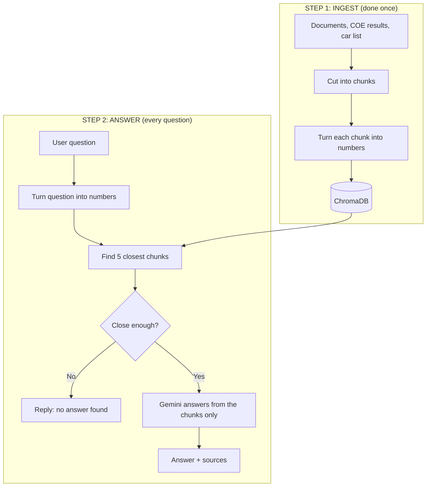
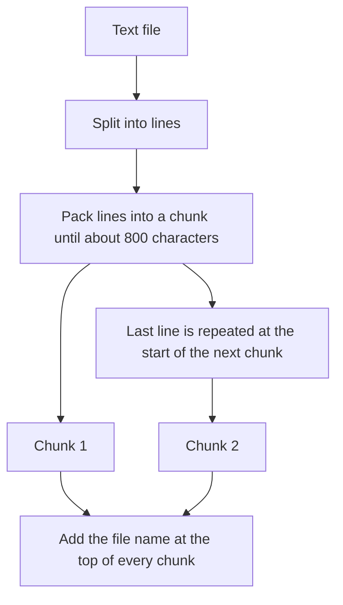
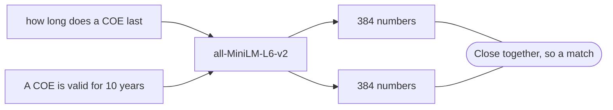
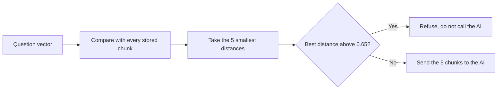
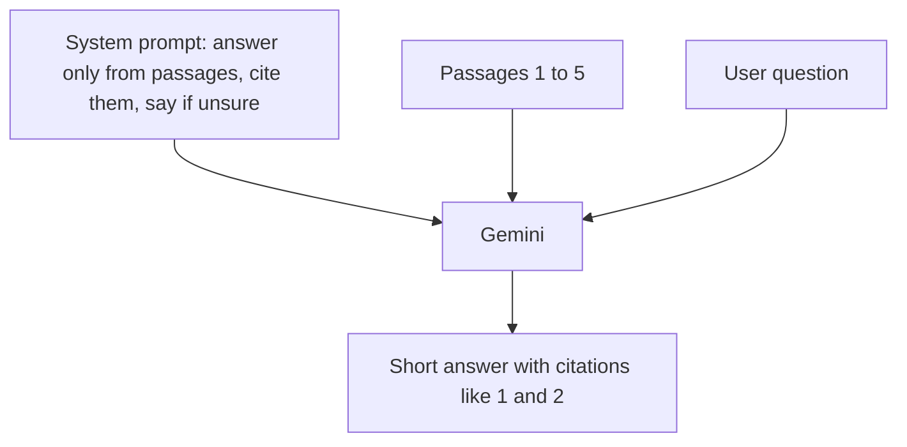

# SG Car Copilot

A personal project: a Q&A assistant for buying and owning a car in Singapore, built with RAG (Retrieval-Augmented Generation).

## Why I built it

Car ownership in Singapore has a lot of moving parts: COE, ARF, OMV, PARF rebate and road tax all interact, and the answers are spread across several pages. I wanted to learn how RAG works end to end by building something practical with a real, changing dataset, using only free tools.

## What it does

- Answers questions about COE, ARF/OMV, PARF/rebate and road tax in plain English.
- Looks up recent COE bidding results (Cat A to E) and approximate prices for about 80 car models.
- Shows which source passages each answer was based on, so it can be checked.
- Says it doesn't know when nothing in the knowledge base is close enough, instead of guessing.
- Includes a cost calculator for the total cost of owning a car over a chosen number of years. The maths is plain Python, so the numbers are exact and not left to the AI.

## How it works

1. **Ingest:** documents are split into small chunks, converted to embeddings with a local `sentence-transformers` model, and stored in a ChromaDB index.
2. **Retrieve:** the question is embedded the same way and the closest chunks are fetched.
3. **Generate:** the chunks and the question go to Google Gemini with strict instructions to answer only from them and cite them. If the closest chunk is too far away, the app refuses to answer.

## Knowledge base

| Source | Content |
|---|---|
| Official OneMotoring pages | COE, ARF/OMV, PARF/rebate and road tax, summarised in my own words |
| COE bidding results | The last 24 bidding rounds, from late Nov 2025 to early Nov 2026 |
| Car price list | About 80 models with approximate prices including COE |

## Technical details

### The big picture

### Chunking
Documents are cut into pieces of about 800 characters. The splitter works line by line, packing whole lines into a chunk until adding the next one would pass the limit, so a sentence is never cut in half. The last line of each chunk is repeated at the start of the next one (a one-line overlap) so context isn't lost at the boundary. Each chunk is also prefixed with its file name (for example `Source: 04_road_tax.md`), which gives the search a hint about the topic.

Structured data is handled differently. Each row of the car list is turned into one sentence, such as "Car model: BYD Atto 3 (SUV, Electric, 5 seats). Approximate price with COE: S$171,888", and each COE bidding round is one line in the results file. One row per chunk keeps prices and categories together.

### Embeddings
An embedding turns text into a list of numbers that captures its meaning, so similar meanings end up close together. I use the `all-MiniLM-L6-v2` model from `sentence-transformers`, which runs locally and free, and produces a 384-number vector for each chunk. The question is embedded with the same model at search time. Because the match is on meaning, not exact words, "how long does a COE last" can find a passage that says "valid for 10 years".

Texts with similar meaning get similar numbers, so they land near each other. Texts about different topics land far apart.

### Vector store and retrieval
The vectors are stored in ChromaDB with cosine distance (0 means identical meaning, larger means less related). For each question the app fetches the 5 closest chunks. If even the best chunk has a distance above 0.65, the app does not call the AI and replies that it has no answer. This threshold is the main guard against made-up answers.

### What the language model does
The model (Google Gemini, called through the OpenAI-compatible API) never searches anything. It only receives the question plus the 5 numbered passages and a system prompt that tells it to:
- answer only from the passages, and say so if the answer isn't there
- cite the passages it used, like [1] or [2]
- keep the answer short and remind the user to check official sources

Temperature is set to 0.1 so it sticks to the passages instead of improvising. The retrieved passages are shown in the app under "Sources used", so every answer can be checked against its source text.

### Why this is "RAG"
Retrieval finds the facts (from my data), and generation phrases them. The model's own memory isn't trusted for prices or rules, which keeps the answers current and checkable. To update the app, I change the data files and rebuild the index. No model training is needed.

## Design decisions

- **Refuse instead of guess:** a distance threshold stops the AI from answering when retrieval finds nothing relevant.
- **Calculator outside the AI:** language models are unreliable at arithmetic, so costs are computed in Python.
- **One file for provider details:** the AI provider is set in one place, so switching models is a small change.
- **Small evaluation set:** a short list of test questions checks that the right source is retrieved, and that an out-of-scope question is refused.

## Tech

Python, Streamlit, ChromaDB, sentence-transformers (`all-MiniLM-L6-v2`), Google Gemini free tier via the `openai` SDK.

## Data and disclaimer

Data as of 8 November 2026. Rules come from official OneMotoring pages. COE results come from public COE history tables, and car prices are approximate market figures that change often. This is a learning project, not financial advice.
