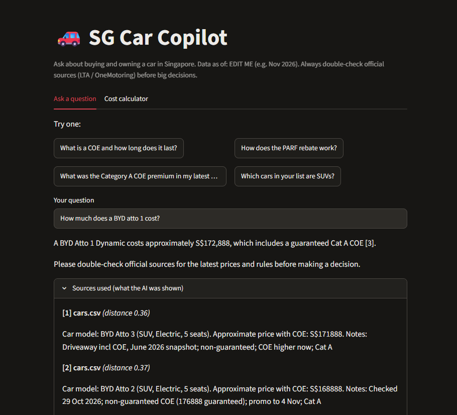

# SG Car Copilot

A personal project: a Q&A assistant for buying and owning a car in Singapore, built with RAG (Retrieval-Augmented Generation).

## Why I built it

Car ownership in Singapore has a lot of moving parts: COE, ARF, OMV, PARF rebate and road tax all interact, and the answers are spread across several pages. I wanted to learn how RAG works end to end by building something practical with a real, changing dataset, using only free tools.

## What it does

- Answers questions about COE, ARF/OMV, PARF/rebate and road tax in plain English.
- Looks up recent COE bidding results (Cat A to E) and approximate prices for about 80 car models.
- Shows which source passages each answer was based on, so it can be checked.
- Says it doesn't know when nothing in the knowledge base is close enough, instead of guessing.
- Includes a cost calculator for the total cost of owning a car over a chosen number of years. The maths is plain Python, so the numbers are exact and not left to the AI.

## How it works

1. **Ingest:** documents are split into small chunks, converted to embeddings with a local `sentence-transformers` model, and stored in a ChromaDB index.
2. **Retrieve:** the question is embedded the same way and the closest chunks are fetched.
3. **Generate:** the chunks and the question go to Google Gemini with strict instructions to answer only from them and cite them. If the closest chunk is too far away, the app refuses to answer.

## Knowledge base

| Source | Content |
|---|---|
| Official OneMotoring pages | COE, ARF/OMV, PARF/rebate and road tax, summarised in my own words |
| COE bidding results | The last 24 bidding rounds, from late Nov 2025 to early Nov 2026 |
| Car price list | About 80 models with approximate prices including COE |

## Design decisions

- **Refuse instead of guess:** a distance threshold stops the AI from answering when retrieval finds nothing relevant.
- **Calculator outside the AI:** language models are unreliable at arithmetic, so costs are computed in Python.
- **One file for provider details:** the AI provider is set in one place, so switching models is a small change.
- **Small evaluation set:** a short list of test questions checks that the right source is retrieved, and that an out-of-scope question is refused.

## Tech

Python, Streamlit, ChromaDB, sentence-transformers (`all-MiniLM-L6-v2`), Google Gemini free tier via the `openai` SDK.

## Data and disclaimer

Data as of 8 November 2026. Rules come from official OneMotoring pages. COE results come from public COE history tables, and car prices are approximate market figures that change often. This is a learning project, not financial advice.
